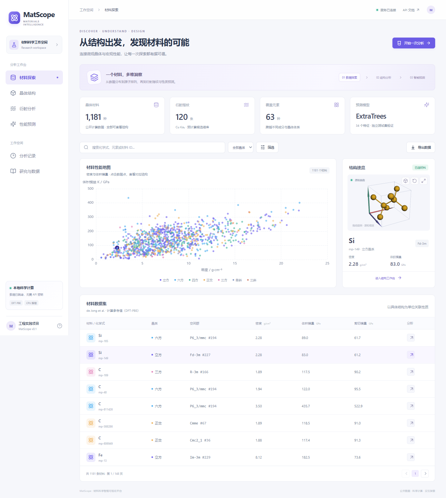

# MatScope · 材料科学智能可视化平台

面向材料科学的工程实践项目，把 **晶体结构 → 模拟衍射 → 候选检索 → 弹性性质预测** 连接到同一交互工作空间。



## 已实现

- **材料探索**：1,181 条公开材料记录，化学式/元素/晶系筛选、密度与模量散点图、联动选择、CSV 导出。
- **晶体结构**：三维晶胞、旋转缩放、2×2×2 超胞、CIF 上传与导出、几何扰动和晶格参数。
- **衍射分析**：pymatgen 正向计算 XRD、峰展宽、上传 CSV/XY、基础基线校正与平滑、寻峰、120 条参考谱的 Top-5 检索与叠加对比。
- **性能预测**：真实训练的 ExtraTrees 回归模型预测 K/G，按约化化学式分组留出独立测试集，展示误差、参考值与特征重要性。
- **分析记录**：SQLite 保存谱图检索和预测结果，恢复记录、HTML 报告与浏览器打印保存 PDF。

技术：React 19 / TypeScript / Vite / ECharts / 3Dmol.js / FastAPI / pymatgen / scikit-learn。前端资源与准备后的数据均从本地加载；日常运行无需材料数据库 API key。

## 快速运行

需要 Python 3.11 或 3.12、Node.js 22+ 和 [uv](https://docs.astral.sh/uv/getting-started/installation/)。推荐 Chrome 或 Edge，需支持 WebGL。

```bash
# 在仓库根目录建立环境，版本由 uv.lock 固定
uv sync --frozen --python 3.11

# 安装和构建前端
cd frontend
npm ci
npm run build
cd ..

# 启动（首次启动会自动训练本地模型）
uv run uvicorn backend.main:app --host 127.0.0.1 --port 8000
```

打开 **http://127.0.0.1:8000**。API 文档：**http://127.0.0.1:8000/docs**。

Windows PowerShell 若阻止 `npm.ps1`，使用 `npm.cmd ci` 和 `npm.cmd run build`。准备完成后可双击根目录的 **`start.cmd`**。系统 Python 3.8 不满足项目要求，uv 会使用独立的兼容版本。

仓库已包含 `data/processed/` 和上传样例，无需在首次展示前重新下载科学数据。第一次安装依赖需要网络；启动后数据准备与分析不需要网络。

可选容器启动：`docker compose up --build`。提供的容器配置尚未在本机执行验证。

## 开发与复现

```bash
# 后端
uv run uvicorn backend.main:app --reload --host 127.0.0.1 --port 8000
# 在另一个终端运行前端
cd frontend
npm run dev
```

Vite 开发地址为 `http://127.0.0.1:5173`，自动代理 `/api` 和 API 文档到后端。

```bash
# 重建科学数据、谱库和模型（需要下载原始公开数据）
uv run python scripts/prepare_data.py
# 仅重训模型
uv run python scripts/train_model.py
# 后端科学与 API 检查
uv run pytest -q
# 启动已构建的服务后运行浏览器检查，本机使用已安装的 Chrome
cd frontend
npm run test:e2e
```

原始数据下载失败时，准备脚本尝试同文件的 S3 存储入口；两者均必须通过官方 SHA256 校验。`uv.lock` 和 `frontend/package-lock.json` 固定依赖版本。

## 模型结果

34 个输入特征：原子序数、原子质量、电负性、原子半径、周期和族的成分加权统计，以及密度、每原子体积、元素数和成分熵。标签是 DFT-PBE 的 `K_VRH`、`G_VRH`；输入不包含弹性标签或衍生弹性字段。

模型使用 240 棵 ExtraTrees、log1p 标签变换、固定随机种子 42；按约化化学式分组约 80%/20% 留出，避免同化学式跨越训练和测试。

| 预测目标 | 测试 MAE / GPa | 测试 R² | 均值基线 MAE / GPa |
| --- | ---: | ---: | ---: |
| 体积模量 K | 14.170 | 0.9080 | 58.815 |
| 剪切模量 G | 13.980 | 0.7490 | 32.639 |

完整样本对照、特征重要性与划分见 `data/processed/model_report.json`、`split.json`。这是一次固定留出评估，未进行官方 Matbench 基准认证。训练集内材料的对照不用于宣称泛化性能。

## 科学含义与边界

- 参考性质来自 **DFT 计算**，不是实验测量。
- XRD 模拟使用 Cu Kα₁ 1.5406 Å，角度范围 5°–90°；峰宽采用高斯展宽。上传谱检索也应使用该波长。
- 候选检索只覆盖当前 120 条参考谱。相似度是谱形分数，不是概率，不支持任意未知结构恢复或混合相定量分析。
- 几何扰动没有进行能量弛豫，不能自动代表可合成、稳定的新材料。
- K/G 描述弹性响应，不能直接等同于硬度或断裂强度。回归模型不适用于所有新材料。
- 当前是本地单用户演示平台，未实现账号、复杂权限、大规模训练或生产级任务系统。

## 数据与论文

数据来自 de Jong et al., *Charting the complete elastic properties of inorganic crystalline compounds*, Scientific Data 2, 150009 (2015). [DOI](https://doi.org/10.1038/sdata.2015.9)。详细来源与校验见 [data/README.md](data/README.md)。模拟加噪 CSV 明确标记为演示谱。

导师相关方向：*XRDMamba*（CIKM 2024）与 *Rethinking Crystal Symmetry Prediction: A Decoupled Perspective*（AAAI 2026）。[AAAI 论文](https://ojs.aaai.org/index.php/AAAI/article/view/38657)、[XRDecoupler 上游仓库](https://github.com/baigeiguai/XRDecoupler)。

**XRDecoupler 尚未部署**；当前实际算法为谱库匹配和 ExtraTrees 性质回归。未复制论文模型代码或权重，也未把基础版结果归因于论文算法。

## 项目结构

```text
backend/              API、科学计算、回归模型
frontend/             React 工作台与浏览器流程检查
data/processed/       准备后的真实数据、谱库与模型评估
data/examples/        CIF 和加噪模拟谱上传样例
scripts/              数据准备和模型训练
tests/                科学规律、数据划分与 API 流程检查
docs/                 调研、演示说明与界面截图
```

[调研与选型](docs/research-and-project-proposal.md) · [演示流程](docs/demo-guide.md) · [本地验证记录](docs/verification.md)

原创代码采用 MIT 许可；数据和第三方依赖保留各自许可及引用。
