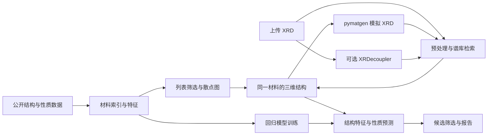

# 材料科学智能可视化平台：调研与项目建议

调研日期：2026-10-02。本文面向课程工程实践：交付可以运行、演示和通过 GitHub 复现的平台。当前阶段是资料调研与设计，没有安装依赖、执行论文模型或下载完整数据集。

**一、推荐结论**

建议项目名称为 **MatScope：晶体结构、衍射与性能智能分析平台**。

核心定位：针对无机晶体材料，把材料数据筛选、三维晶体结构、粉末 X 射线衍射（PXRD）分析和弹性性质预测放在同一条工作流中。以公开数据和轻量机器学习完成基础版，再通过适配器接入导师参与的晶体对称性识别模型。

优先保证四件事：一条完整的材料分析流程；真实可执行的科学计算和机器学习；相互联动的图形；别人克隆后能跑。用户体系、复杂任务队列、多租户和大规模训练暂不纳入首版。

**二、王鹏焜老师的身份与相关研究**

中国科大软件学院的官方介绍显示，王鹏焜老师的研究包括泛化深度学习、时空数据挖掘，以及化学材料等交叉应用。这里按中国科大这位老师开展调研。同名英文作者较多，检索结果中的福建物构所发光材料、其他机构生物或金属材料论文，不能仅凭名字归到他名下。

来源：[中国科大软件学院教师介绍](https://sse.ustc.edu.cn/2023/1212/c19871a626051/page.htm)。该介绍发布于 2023 年，用于核实身份和研究方向，不作为最新职称的唯一依据。

| 论文 | 已核实的发表信息 | 与项目的关系 |
| --- | --- | --- |
| XRDMamba: Large-scale Crystal Material Space Group Identification with Selective State Space Model | CIKM 2024，DOI：10.1145/3627673.3680006；王鹏焜为作者，论文标注通讯作者 | 从 XRD 谱识别空间群，是谱图工作台的直接研究背景 |
| Rethinking Crystal Symmetry Prediction: A Decoupled Perspective | AAAI 2026，40(19):16208–16216，DOI：10.1609/aaai.v40i19.38657；王鹏焜为作者 | XRDecoupler 利用晶体对称性信息辅助预测，适合输出晶系、晶格类型、点群和空间群 |
| A Powder Diffraction-AI Solution for Crystalline Structure | arXiv:2411.06062，2024-11-09；作者包含王鹏焜 | 研究从粉末衍射解析晶体结构，可用于介绍平台的长远目标 |
| Soft causal learning for generalized molecule property prediction: An environment perspective | arXiv:2505.06283，2025-05-07；作者包含王鹏焜 | 分子性质与分布外泛化方向，可作为以后扩充分子模块的背景 |

对应来源：[XRDMamba 论文](https://openreview.net/pdf?id=WH6UIqcZSN)、[AAAI 正式论文页面](https://ojs.aaai.org/index.php/AAAI/article/view/38657)、[粉末衍射结构解析预印本](https://arxiv.org/abs/2411.06062)、[分子性质预测预印本](https://arxiv.org/abs/2505.06283)。

本次核实了直接相关的会议论文与预印本，但不能据此声称已核实题目背景里的“多篇材料方向顶级期刊论文”。预印本的后续期刊归属没有在本次检索中得到确认。项目报告应按已确认的正式出处引用。

**三、论文代码是否适合直接接入**

[XRDMamba 仓库](https://github.com/WoooShuang/XRDMamba)公开了模型、工具和训练入口。本次浏览的根目录没有显示成熟的安装说明与预训练权重，因此工程优先级低于较新的 XRDecoupler。

[XRDecoupler 仓库](https://github.com/baigeiguai/XRDecoupler)提供示例、权重包入口与推理脚本。本次实际读取了公开的 `case_try.py`、`requirements.txt` 和编码器源码，得到以下接入依据：

- 推理脚本将模型映射到 CPU，编码器使用卷积和注意力模块；源码检查支持“可以优先尝试 CPU 推理”的判断，但速度、内存和可运行性仍需实测。
- 依赖文件固定 `numpy==1.24.0`、`torch==2.0.1`、`torchmetrics==1.3.1`。示例数据还依赖序列化对象所属库，三行依赖不应视为完整环境保证。
- 数据处理设定 5°–90°、长度 8500。脚本把峰强度装入固定网格，不能直接假设任意实验连续谱 CSV 都符合训练输入分布。
- 四个任务头为 `sp`、`lt`、`cs`、`pg`。示例脚本主要打印空间群 Top-5；平台需将各头输出改成结构化响应，并核对类别编号映射。
- 权重包在 Git 中是 LFS 指针，指针记录实际体积 112,390,228 字节，约 112 MB（107 MiB）。直接下载 raw 文件可能只得到指针；真实权重下载尚未验证。

改造时需补 `eval()` 和 `torch.inference_mode()`，处理角度边界，去除预测输入对真实标签的依赖，并核对强度缩放和模型加载方式。不要把全新 PyTorch 与原始权重能直接兼容当作前提。

建议先给论文接入一个半天左右的验证预算：下载并核对权重 → 原始案例跑通 → 核对输入与标签映射 → 再封装 API。若受环境或数据分布阻碍，先完成基础版，保留论文适配器接口和准确的状态说明。

仓库目录中本次未见 LICENSE。准备公开发布时应核实代码与权重的使用条款，优先保留上游引用和下载入口，避免把公开可见自动等同于可任意重新授权。

**四、几个可选主题的比较**

| 主题 | 展示内容 | 工程特点 | 建议 |
| --- | --- | --- | --- |
| 晶体结构、XRD 与弹性性质 | 原子晶胞、衍射峰、性质散点图、候选检索、回归预测 | 公开数据和工具可把各模块关联起来，与导师研究接近 | 首选 |
| 光电材料与带隙预测 | 化学组成、三维结构、带隙筛选、回归预测 | 入门容易，但必须选择含结构的数据集，才能连上三维展示 | 备选 |
| 显微图像与晶粒分析 | 分割覆盖图、晶粒尺寸、面积分布 | 图像展示直观，但标注、分割效果和性质关联需要额外处理 | 后续独立扩展 |
| 电池材料与循环寿命 | 容量衰减、循环曲线、寿命预测 | 数据多为电芯和工况，与原子结构的关联需要另一套数据 | 不适合本次主线 |

这是基于本项目交付目标的工程判断，并非各研究方向的学术价值排名。

**五、数据选型：先选同一份含结构和性质的数据**

首选 matminer 的 `elastic_tensor_2015`。官方资料列出 1,181 条结构及 DFT-PBE 弹性数据，包含 `structure`、`material_id`、化学式、空间群、体积，以及体积模量 `K_VRH`、剪切模量 `G_VRH`、泊松比和弹性张量。

来源：[matminer 数据集说明](https://hackingmaterials.lbl.gov/matminer/dataset_summary.html#elastic-tensor-2015)。原始论文为 de Jong 等人的 *Charting the complete elastic properties of inorganic crystalline compounds*，Scientific Data，2015。

同一条结构记录可以用于：生成三维晶胞；计算密度和结构特征；计算模拟 XRD；显示数据库弹性性质；构建性质预测样本。这样各页面共享材料标识，数据不会靠化学式随意拼接。

实施范围建议：先筛选 50–100 个原子数较少、结构有序、可解析的材料用于默认谱库和交互演示；其余合格记录用于列表、散点图和回归训练。最终保留数量以下载和清洗结果为准，不能预先声称所有条目都可用。

备选数据：`dielectric_constant` 的 1,056 条结构与介电数据适合光学材料主题；`matbench_expt_gap` 的 4,604 条记录只有组成和实验带隙，不能单独提供晶体结构。二者均可在上述官方数据目录核查。

补充结构可从 [Crystallography Open Database](https://crystallography.net/cod/)选取。COD 官方说明数据为公共领域并采用 CC0，同时要求认可结构原作者。保存 COD 编号和原文引用。

首版数据一次下载后缓存。运行时不要求访问远程数据库；Materials Project 的在线 API 可作为后续扩展，其使用需要 API key，参见[官方入门文档](https://docs.materialsproject.org/downloading-data/using-the-api/getting-started)。

**六、适合展示的材料学内容**

1. **晶体结构**：展示晶胞参数、原子位置、元素颜色、空间群、晶系和 2×2×2 超胞。可挑选 Fe、Cu、Al、Si 等易理解的例子，具体结构以已取得的记录为准。
2. **同成分不同结构**：例如 TiO₂ 的不同晶型；如果主数据集缺少所需条目，可用 COD 补齐三维和 XRD 对照。补充结构没有弹性标签时，明确显示缺失，不能按同一化学式套用其他晶型的数据。
3. **结构与衍射联动**：改变晶格整体尺度，观察谱峰位置变化，用布拉格关系解释。标记为几何扰动模拟，不自动视为真实平衡材料。
4. **微观描述与宏观性质**：用密度、每原子体积、成分统计等特征关联 K、G；展示分布和模型预测误差。K 是抗体积压缩的指标，G 是抗剪切的指标，二者不能直接当成硬度或断裂强度。
5. **候选筛选**：输入低密度、高 K 或高 G 等条件，获得排序候选，再打开其结构和模拟谱图。筛选阈值依据数据分布设定，不预先保证存在满足所有条件的材料。

**七、基础版功能与页面**

| 页面 | 核心功能 | 完成标准 |
| --- | --- | --- |
| 材料探索 | 元素和性质筛选、材料表格、密度—模量散点图 | 点击同一材料，所有图形和详情能同步 |
| 结构工作台 | CIF 导入、晶胞与超胞、结构元数据、几何扰动模拟 | 上传样例能渲染；显示来源和单位 |
| XRD 工作台 | CSV/XY 导入、基础平滑与寻峰、模拟谱、Top-k 谱库检索、叠加对比 | 默认样例完整跑通；检索结果可打开候选结构 |
| 性能预测与筛选 | K/G 预测、数据库参考值对照、测试集误差图、候选排序 | 真正执行已训练模型；预测与参考值有明确区分 |

历史记录与导出作为全局功能：保存材料 ID、输入、参数、算法版本和结果；导出 CSV、图像及可浏览器打印的 HTML 报告即可。

**八、算法如何结合**

基础版采用三种职责明确的计算：

- **科学计算**：pymatgen 解析结构与计算 XRD。`XRDCalculator` 返回角度、强度、晶面族和晶面间距；连续谱需另做峰展宽。谱图标注 2θ、波长和模拟来源。参见 [pymatgen 衍射文档](https://pymatgen.org/pymatgen.analysis.diffraction.html)。
- **谱库检索**：统一角度网格后，用余弦相似度等方法排序已知结构的模拟谱，可做有限角度偏移匹配。结果叫“库内候选”和“相似度”，不能称为从任意谱图完整恢复未知结构，也不能把相似度显示成校准概率。
- **机器学习性质预测**：matminer 提取成分统计，结合密度、每原子体积等结构特征，使用 ExtraTrees 或 RandomForest 回归预测 K、G；训练后保存模型供 API 推理。参见 [ExtraTrees 官方文档](https://scikit-learn.org/stable/modules/generated/sklearn.ensemble.ExtraTreesRegressor.html)。

论文增强版添加 XRDecoupler 的空间群及其他对称性预测。空间群结果用来辅助筛选谱库候选；空间群本身不能唯一决定原子坐标，所以仍需已知结构库或独立结构解析算法提供三维模型。

回归验证使用独立测试集，并按约化化学式或结构分组，防止同源记录跨越训练和测试。预处理也只在训练集拟合。显示 MAE、R²，并与简单均值基线比较。K/G 及其衍生弹性字段不能进入预测 K/G 的输入特征。分组工具可参考 [GroupShuffleSplit](https://scikit-learn.org/stable/modules/generated/sklearn.model_selection.GroupShuffleSplit.html)。

PCA 二维图可作为低成本扩展。每个点对应同一材料 ID，颜色表达参考性质或晶系；投影距离只表达所选特征表示中的相近程度，不能声称证明物理因果关系。

**九、技术栈建议**

| 层次 | 推荐 | 原因 |
| --- | --- | --- |
| 前端 | React + TypeScript + Vite | 适合仪表盘和多个联动工作台，SPA 足够 |
| 界面 | Tailwind CSS，配一套统一组件 | 保持按钮、表格和控件风格一致 |
| 图表 | Apache ECharts | 谱线、散点、柱状和交互事件统一实现 |
| 三维 | 3Dmol.js | 已有 CIF、晶胞和超胞相关能力，减少自行写渲染器的工作 |
| 后端 | FastAPI + Pydantic | 与 Python 科学计算衔接，自动生成 API 文档 |
| 科学计算 | pymatgen、NumPy、SciPy、pandas | 结构、衍射和数值分析 |
| 基础 AI | matminer + scikit-learn + joblib | 少量数据可用 CPU 训练和推理 |
| 论文 AI | 独立环境中的 PyTorch / XRDecoupler | 隔离论文旧依赖，避免阻塞主服务 |
| 存储 | SQLite + 本地数据与文件目录 | 保存材料索引和分析记录，部署简单 |
| 启动 | 本地启动脚本；可选 Docker Compose | Windows 本地演示和他人复现都能覆盖 |

选型依据：[Vite 官方入门](https://vite.dev/guide/)、[ECharts 交互事件](https://echarts.apache.org/handbook/en/concepts/event/)、[3Dmol 晶胞与超胞接口](https://3dmol.org/doc/GLViewer.html)、[FastAPI 自动 API 文档](https://fastapi.tiangolo.com/tutorial/first-steps/)。

选择一套经验证的依赖版本并锁定。平台科学计算与旧论文模型可以分别运行，通过 JSON 或本地子进程通信。前端和第三方视觉资源本地打包，减少演示时对 CDN 的依赖。

如果只求最快形成页面，Streamlit 是可考虑的原型路线；考虑题目强调前后端平台以及展示效果，最终建议 React + FastAPI。已有 Vue 经验的团队也可使用 Vue + Vite，不必为了本方案更换熟悉的框架。

**十、系统如何串成整体**

所有模块共享稳定的材料 ID 和分析 ID。每个字段记录来源：公开计算参考值、由结构确定的量、模拟谱图、机器学习预测或用户上传数据。数据源标签在确实影响理解的位置显示。

简化 API 可以包括材料查询、结构解析、XRD 模拟、谱库检索、性质预测、分析记录和报告导出；无需为了工程外观引入微服务体系。

**十一、建议演示脚本**

1. 打开材料探索页，按元素或模量筛选，在散点图选中材料。
2. 打开其三维结构，旋转晶胞并切换超胞。
3. 生成该结构的 XRD，查看峰标签、参数和来源。
4. 用内置的加噪模拟谱作为上传样例，检索候选，叠加观察匹配结果。明确这是模拟演示数据。
5. 可选运行论文模型，显示对称性预测，与所选结构的已知对称性对照。
6. 打开独立测试集样例，运行 K/G 预测，显示模型误差和参考值。
7. 筛选候选并导出报告。

演示可以控制在约 3–5 分钟，重点是选择动作能引起关联图形和计算结果变化。

**十二、实施优先级与 GitHub 交付**

依次完成：数据下载清洗和来源记录 → 单条结构三维展示与 XRD → 材料筛选与联动 → 谱库检索 → 回归模型与独立评估 → 记录和导出 → 论文模型接入 → 启动验证与演示材料。

论文模型的原始案例验证可以提前开展，但它不应成为基础版的前置条件。基础版使用真实训练的轻量模型，已经包含 AI 算法、科学工具和交互可视化。

建议仓库包含：`frontend/`、`backend/`、`data/`、`scripts/`、`docs/`；提供数据准备与训练脚本、锁定依赖、Windows 启动方式、样例 CIF/CSV、数据来源、截图、短演示和已知限制。参考数据的再分发范围在数据准备阶段核实，大权重提供明确下载步骤。

验收只做与演示直接相关的检查：干净环境启动；默认案例完整流程；上传合法样例；联动 ID 正确；单位和类别映射正确；独立模型评估；报告可打开。离线运行是完成数据准备和依赖安装之后的目标，不宣称初次安装也无需联网。

首版可保留的限制：单用户、固定候选谱库、上传格式有限、同步分析、小型模型、未经广泛实验谱验证。这些限制应写进 README；结果与实际实现保持一致即可。
